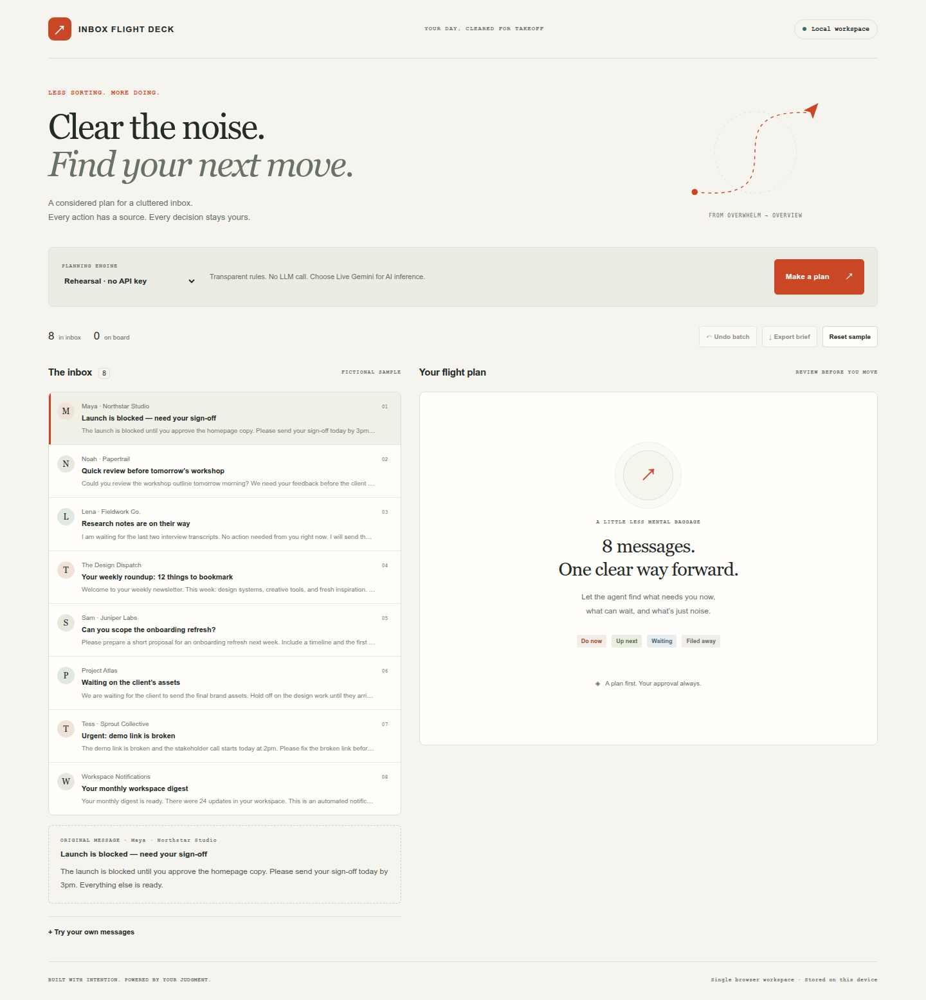
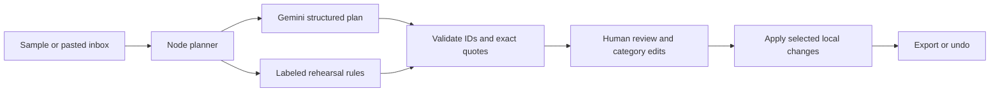

# Inbox Flight Deck ↗

**Clear the noise. Find your next move.**

A small TypeScript/Node inbox triage agent for independent consultants. Turn mixed messages into a plan with **verbatim source evidence**, adjust the categories, apply only the decisions you choose, export a brief, and undo a whole batch.



## Run in three steps

Prerequisite: **Node.js 22+**. From this repository:

1. `npm ci`
2. `npm run build`
3. `npm start` — open **http://localhost:3000**.

Choose **Make a plan**. Rehearsal mode needs no credentials and labels itself as deterministic rules, with no LLM call. The eight sample messages are fictional. This is a local app; no mailbox is connected and no emails are sent or deleted.

## Use the real AI agent

Create `.env` from [.env.example](.env.example), set `GEMINI_API_KEY` locally, and restart the server. Choose **Live Gemini** before requesting a plan. The default model is `gemini-3.8-flash`; override with `GEMINI_MODEL` if needed for your account. Messages go to Google only when you explicitly request a live plan. Credentials stay on the Node server, outside source control and the browser bundle. API usage is subject to your account's billing and limits.

Real Gemini inference and the production browser journey were verified on 2026-10-23. See [verification evidence](docs/VERIFICATION.md). A live failure is shown explicitly; there is no silent fallback to rehearsal.

## Try the complete loop

1. Make a plan. Read the action, rationale and source quote; **Inspect original** shows the source message.
2. Uncheck a decision and change a category. **Apply N decisions** moves only those messages to your local board.
3. **Export brief**, reload, then **Undo batch**. The prior inbox and board return, including across reloads.

**Try your own messages** accepts blank-line-separated text blocks; the first line is the subject. Limit: 20 messages, 6,000 characters each and 24,000 total including metadata. Import replaces the session and its undo history; non-sample sessions require confirmation. **Reset sample** restores the fictional inbox, with confirmation if it would replace your work.

Browser storage holds this workspace on the same origin. Use one tab; this proof of concept does not synchronize concurrent tabs or devices. Storage errors are surfaced and the app can continue in memory. Original inbox text is retained with board decisions. Export or reset when done; this is not an encrypted mailbox client.

## How the agent works



The model returns bounded JSON, one decision per message: `now`, `next`, `waiting`, or `archive`. The server rejects missing, repeated or invented IDs and quotes that do not occur exactly in the corresponding message body. The person can still disagree with the model: exact evidence establishes provenance, not correct judgment. The deterministic executor can only update the local board after selection.

## Development and verification

```sh
npm run dev           # same URL, Vite middleware and Node API
npm run check         # strict typecheck, unit/API tests, production build
npm run test:browser  # production browser journey, after npm run build
npm run test:live     # optional real Gemini call; requires server-side key
```

Browser checks use system Chrome at `/usr/bin/google-chrome`, or `CHROME_PATH`, or Playwright Chromium (`npx playwright install chromium`). To include a real API call in that journey on Linux/macOS: `LIVE_BROWSER=1 npm run test:browser`. Ordinary tests do not call external APIs. `PORT=3001 npm start` chooses another port.

If a restricted runner has a broken temporary directory, prefix commands with `TMPDIR=/tmp` (Linux/macOS). Production `npm start` does not require tsx. For browser tests, `TEST_PORT` selects their isolated server port (default 4173).

## Plan-first provenance

Built from a newly created **empty folder on 2026-10-23**, during the hackathon submission window. No existing project code was reused. Devpost Learn Skill Pack was installed with `npx skills add challengepost/learn-ai-basics --all -y`; its canonical files are in [.agents/skills](.agents/skills), with upstream MIT notice. Planning was committed before application code.

- [Scope](devpost/scope.md) · [PRD](devpost/prd.md) · [Technical spec](devpost/spec.md)
- [Build checklist and revisions](devpost/checklist.md) · [Offline app map](devpost/app-map.html)
- [Workflow provenance and adaptations](docs/WORKFLOW.md)
- [Demo recording guide](DEMO.md) · [Submission kit for PW](SUBMISSION-KIT.md) · [Work state](WORK-STATE.md)

The owner explicitly delegated concept selection and autonomous implementation. Interactive interview/review steps were adapted to that instruction and are documented honestly; no learner hands-on review, personal reflection or submitted video is claimed.

## Install at the originally requested location

This session's writable roots excluded `/home/schultze/Factory/HCTN/`. Source was created in a new empty workspace child directory instead. On the owner's machine, with write access and the destination absent:

```sh
git clone https://github.com/Schultzenator/build-with-ai-basics-2026.git /home/schultze/Factory/HCTN/build-with-ai-basics-2026
cd /home/schultze/Factory/HCTN/build-with-ai-basics-2026
```

Then follow the three startup steps. Cloning preserves the original planning-first history; it does not reuse an old project.

## Attribution and license

New application code, fictional data, CSS and SVG were created for this entry with Codex. Standard dependencies are recorded in `package-lock.json`; their respective licenses apply. The pre-existing **Devpost Learn Skill Pack** is the required development curriculum, credited in [THIRD-PARTY-NOTICES.md](THIRD-PARTY-NOTICES.md). No external images, fonts, music or existing application code are included.

Application: [MIT](LICENSE).
